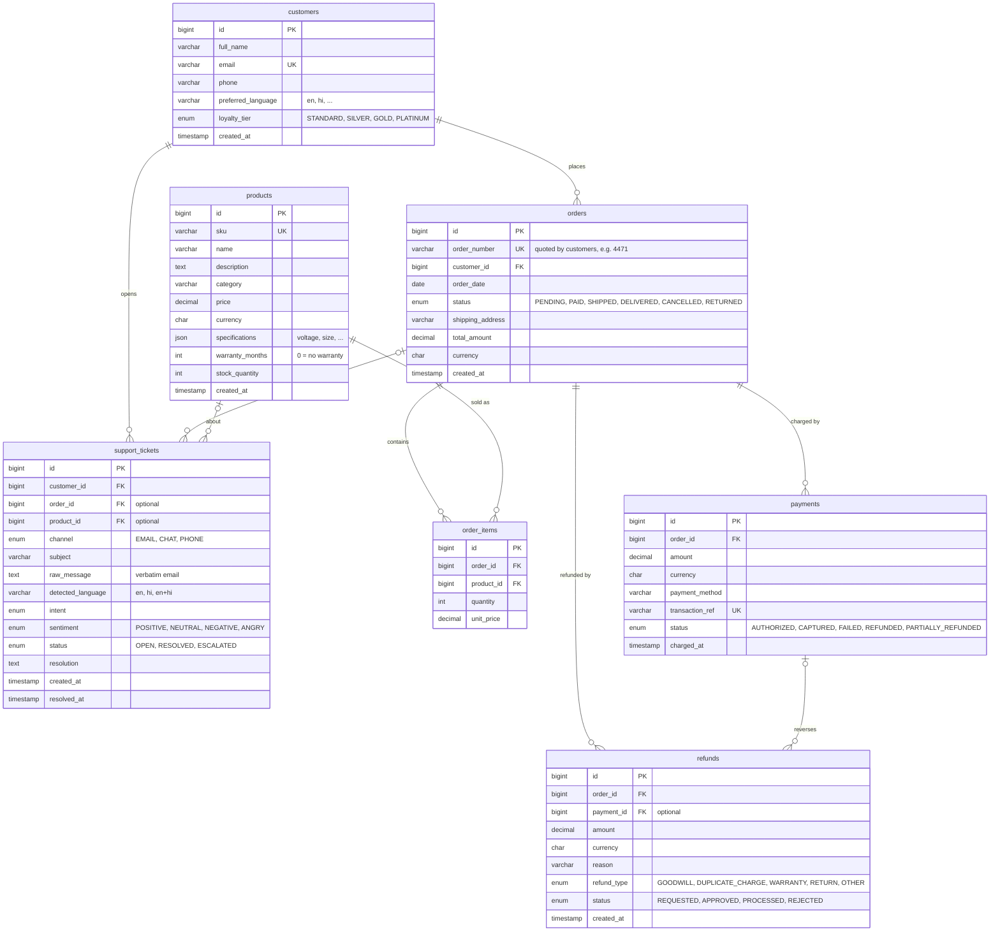

# mcp-server

Spring Boot MCP server that gives the support agent its tools. Each tool reads or
changes customer, order, payment, refund and ticket data in MySQL.

- Java 25, Spring Boot 4.1, Spring AI 2.0
- MCP over streamable HTTP at `http://localhost:8090/mcp`
- Listens on `127.0.0.1` only, because it has no login

## Run

Docker must be running. Spring Boot starts MySQL from `compose.yaml` for you.

```bash
./mvnw spring-boot:run
```

On a fresh volume, MySQL runs `db/init/01-schema.sql` and `db/init/02-seed.sql`.
The data is kept in the `mysql-data` volume, so to load the seed data again, remove
the volume:

```bash
docker compose down -v
```

## Tools

| Tool | What it does |
|---|---|
| `lookup_customer_by_email` | Customer name, contact details, language and loyalty tier |
| `get_customer_orders` | A customer's orders with line items and payments, newest first |
| `get_order_by_number` | One order with line items and payments |
| `search_products` | Search the catalog by name or SKU fragment |
| `get_product_by_sku` | One product with its specifications |
| `detect_duplicate_charges` | Flags repeated charges of the same amount on an order |
| `check_warranty` | Whether a product on an order is still under warranty |
| `get_customer_ticket_history` | Past support tickets, newest first |
| `issue_refund` | Records a refund and updates the payment it reverses |
| `log_support_ticket` | Records the interaction and its resolution |

### Refund rules

`issue_refund` refuses a refund when:

- the order does not belong to `customerEmail`
- the amount is zero, negative or has more than 2 decimals
- a refund with the same amount already exists on the order (rejected refunds don't count)
- it would refund more than was paid on the order or on the given payment
- the given payment belongs to another order or is not `CAPTURED` / `PARTIALLY_REFUNDED`

When the order's refunds would total more than `support.refund.auto-approve-limit`,
the refund is saved as `REQUESTED` and no payment changes. Otherwise it is
`PROCESSED`. If a `transactionRef` was given, that payment becomes `REFUNDED` or
`PARTIALLY_REFUNDED`; without one, no payment changes. There is no
approval screen yet; a person reviews `REQUESTED` rows in the `refunds` table.

## Configuration

`src/main/resources/application.properties`:

| Property | Default | Meaning |
|---|---|---|
| `server.port` | `8090` | HTTP port |
| `server.address` | `127.0.0.1` | Only this machine can connect |
| `support.refund.auto-approve-limit` | `50` | Order refund total above which refunds wait for a person |
| `spring.datasource.*` | `localhost:3306/mydatabase` | MySQL connection, matching `compose.yaml` |

Hibernate never changes the schema (`ddl-auto=none`); the SQL files own it.

## Database schema

Defined in `db/init/01-schema.sql`. All tables use `utf8mb4`, so emails with emoji
or Hindi are stored as written.



An order can have more than one captured payment; that is how
`detect_duplicate_charges` finds a double charge. `support_tickets` is also the
history the agent reads to spot a repeat failure.

## Demo data

`db/init/02-seed.sql` is built for four sample emails:

1. Sarah: a blender with a cracked jug for the third time, which may justify a goodwill refund
2. A pre-sales question about whether the X200 works on European voltage
3. Priya: charged twice for order `4471`, so one charge should be refunded
4. Rohan: a sarcastic, half-Hindi email with two issues

Dates are relative to the day the volume is created.

## Tests

`SupportActionToolsTest` covers the refund rules with mocks and needs nothing running:

```bash
./mvnw test -Dtest=SupportActionToolsTest
```

`McpServerApplicationTests` starts the full app. Spring Boot does not start
`compose.yaml` during tests, so start MySQL first:

```bash
docker compose up -d
./mvnw test
```
