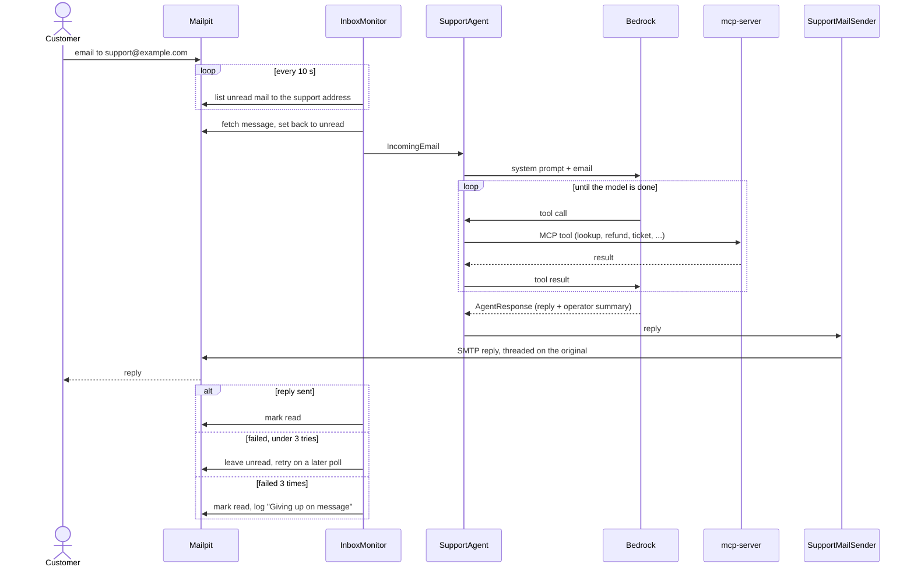

# support-agent

Spring Boot app that answers support emails on its own. It polls a Mailpit inbox,
hands each new email to an AWS Bedrock model that works the case with the
[mcp-server](../mcp-server) tools, and emails the reply back to the customer.

- Java 25, Spring Boot 4.1, Spring AI 2.0
- HTTP on `http://localhost:8080`, listening on `127.0.0.1` only
- Mailpit for SMTP (`1025`) and its web UI and REST API (`8025`)

## Run

Start `mcp-server` first. Docker must be running; Spring Boot starts Mailpit from
`compose.yaml` for you.

The model runs on AWS Bedrock, so the app needs three values. Either export them:

```bash
export AWS_ACCESS_KEY_ID=...
export AWS_SECRET_ACCESS_KEY=...
export BEDROCK_MODEL_ID=...
./mvnw spring-boot:run
```

or put them in a git-ignored `secrets.properties` in this folder:

```properties
spring.ai.bedrock.aws.access-key=...
spring.ai.bedrock.aws.secret-key=...
BEDROCK_MODEL_ID=...
```

Run from this folder (in an IDE, set the working directory to `support-agent`):
both `compose.yaml` and `secrets.properties` are looked up there.

Send a test email, then watch the reply arrive at http://localhost:8025:

```bash
curl -X POST "http://localhost:8080/seed-mail" --data-urlencode "from=priya.sharma@example.com" --data-urlencode "subject=Charged twice for order 4471" --data-urlencode "body=Hi, I was charged twice for order 4471. Please refund the duplicate."
```

`/seed-mail` takes `from`, `subject` and `body`, all optional. It returns `502` when
Mailpit is not reachable. The Postman collection at the repo root,
`support-agent-demo.postman_collection.json`, has ready-made requests.

## How it works



1. `InboxMonitor` asks Mailpit for unread mail sent to the support address, every
   10 seconds by default. The agent's own replies are skipped.
2. Each message stays unread until it is handled, so a crash does not lose it.
3. `SupportAgent` sends the email to the model with the system prompt in
   `src/main/resources/prompts/support-agent-system.st`. The model calls the MCP
   tools it needs and returns an `AgentResponse`: the reply subject and body, plus
   a summary for the operator.
4. `SupportMailSender` sends the reply, threaded onto the original email, and
   `InboxMonitor` marks the message read.

A failed email is tried 3 times. After that it is marked read and the log says
`Giving up on message`, so a person must handle it. The attempt count is kept in
memory, so it resets when the app restarts.

## Configuration

`src/main/resources/application.properties`:

| Property | Default | Meaning |
|---|---|---|
| `spring.ai.bedrock.aws.access-key` / `secret-key` | `${AWS_ACCESS_KEY_ID}` / `${AWS_SECRET_ACCESS_KEY}` | AWS credentials, from the environment or `secrets.properties` |
| `spring.ai.bedrock.aws.region` | `eu-west-2` | AWS region the model is called in |
| `spring.ai.bedrock.converse.chat.model` | `${BEDROCK_MODEL_ID}` | Bedrock model id |
| `server.address` | `127.0.0.1` | Only this machine can connect |
| `support-agent.inbox.base-url` | `http://localhost:8025` | Mailpit REST API |
| `support-agent.inbox.address` | `support@example.com` | The support mailbox |
| `support-agent.inbox.poll-interval` | `10000` | Milliseconds between polls |
| `support-agent.inbox.batch-size` | `50` | Unread messages read per poll |
| `spring.mail.host` / `spring.mail.port` | `localhost` / `1025` | Mailpit SMTP |
| `spring.ai.mcp.client.streamable-http.connections.support-agent.url` | `http://localhost:8090` | mcp-server address |

Mailpit stores its mail in `./data`.

## Tests

`InboxMonitorTest` covers the unread and retry handling with mocks and needs nothing
running:

```bash
./mvnw test -Dtest=InboxMonitorTest
```

`SupportAgentApplicationTests` starts the full app, which connects to mcp-server at
startup. Start mcp-server first and provide the AWS values as above, then:

```bash
./mvnw test
```
